# Camera Games

Movement-based games for children, played in front of a webcam.

| | |
|---|---|
| 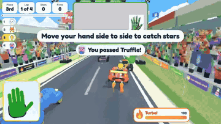<br>**High Five Racers:** open hand to drive | 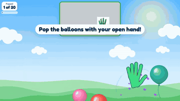<br>**Balloon Pop:** open hand to pop |
| 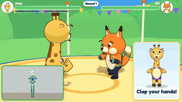<br>**Mighty Moves:** fight with whole-body moves | 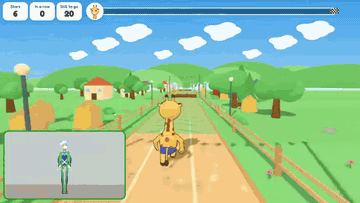<br>**Leap Trail:** jump and step side to side |
| 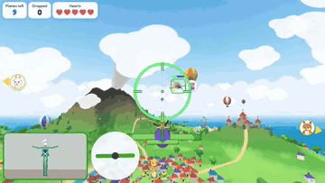<br>**Sky Wings:** fly with your arms | 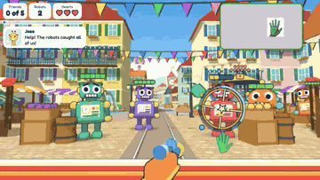<br>**Robot Rescue:** open to fire, close to shield |
| 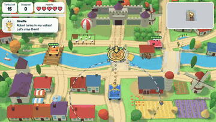<br>**Tank Patrol:** close to drive, open to fire | 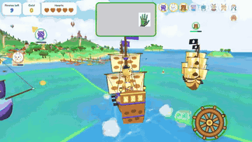<br>**Cannon Bay:** steer a ship with one hand |
| 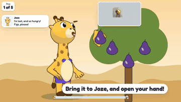<br>**Joze's Long Walk Home:** carry fruit to Joze | 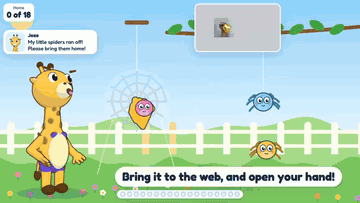<br>**Spider Catcher:** catch spiders, take them home |
| 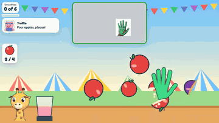<br>**Smoothie Stand:** slice fruit with an open hand | 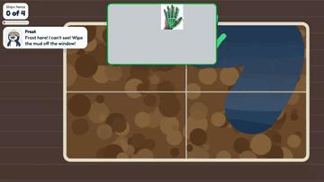<br>**Lighthouse Keeper:** wipe the windows clean |

- Resting never costs anything.
- Each game has 10 levels.
- A grown-up can change the settings under the gear icon.
- The camera picture stays on your computer.

## Play

You need a computer with a webcam, Google Chrome and Python 3.

```
python3 tools/serve.py
```

Then open <http://localhost:8642> in Chrome.

Full details: [readme-details.md](readme-details.md)
